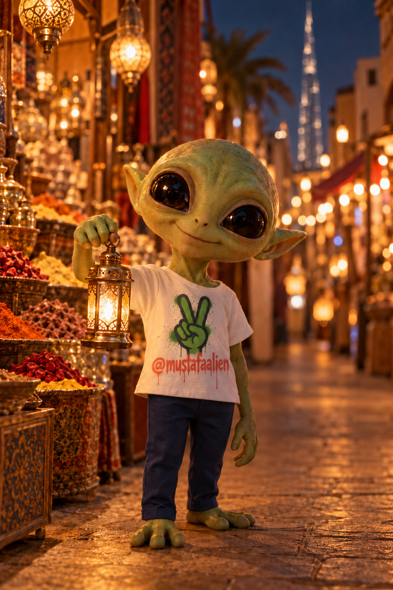

# 👽 ALIEN Image Connector

### Make images with your ChatGPT plan, inside Claude

No API key. No extra cost. The picture pops up in the chat in about a minute.

`FREE` · `macOS` · `gpt-image-2` · `Claude Desktop`

  
  
  

All three made with this tool, from a chat in Claude.

---

## ⬇️ Download — it's free

Go to **Releases** (right side of this page) → download the zip (or tap the green **Code** button → **Download ZIP**).

---

## Why I built it

I'm Mustafa, a creative director in Dubai. I already pay for ChatGPT, and I work with Claude every day.
I didn't want to pay again for an image API or keep jumping between two apps.
So I built a bridge: I ask Claude, ChatGPT draws, and the image lands right in my chat.

---

## What it does

| | |
|---|---|
| **Uses your ChatGPT plan** | Runs through OpenAI Codex, signed in with your account. No API key, ever. |
| **Shows the image in chat** | About a minute per image, with a progress %. Works from your phone too. |
| **Fast or Best** | Claude asks before each image: ⚡ Fast (~1 min) or 💎 Best quality (~2–3 min). |
| **Keeps your character** | Give a reference image and say only what to change — same face, same scene. |
| **Tracks your usage** | After every image: how much of your 5-hour and weekly limit it used. |

---

## Install in 3 steps

1. Download the zip and unzip it.
2. Open **Terminal**, type `bash ` (with a space), drag in **Install ALIEN Image Connector.command**, press **Enter**. Sign in to ChatGPT if it asks.
3. Quit Claude (**Cmd+Q**), open it again, and say: *"Make an image with ALIEN of …"*

Your images are saved in: **Pictures › ALIEN Images**

## You need

- A Mac
- A paid ChatGPT plan (Plus or higher)
- The Claude desktop app
- Node.js ([nodejs.org](https://nodejs.org), LTS)

Images count toward your ChatGPT plan limits.
Windows version — coming soon.

---

## License

Free to use. Please don't re-upload, rebrand, sell or publish changed versions — see [LICENSE](LICENSE).
Not affiliated with OpenAI or Anthropic.

Part of **👽 ALIEN Connectors** · **Made by Mustafa Ali** · follow for more free AI tools → [@mustafaalien](https://instagram.com/mustafaalien)
